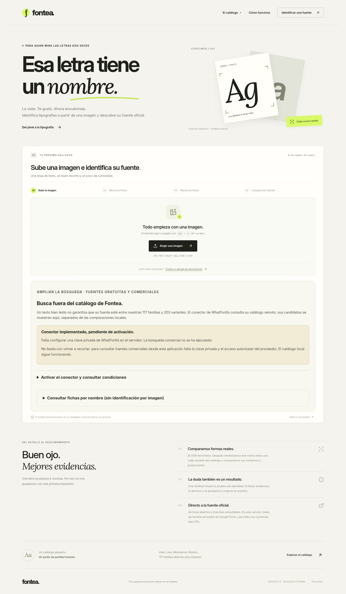

# Fontea

Versión 0.6: [conector externo real, controles y activación pendiente de clave](docs/MEJORAS-0.6.md). Se conserva la [comparación privada de archivos](docs/MEJORAS-0.5.md). Se mantiene la ampliación de [117 familias y mediciones 0.4](docs/MEJORAS-0.4.md). Se conservan todos los commits anteriores en la misma rama y PR.

Aplicación web en español para buscar la tipografía de una imagen y consultar su origen y licencia. **Primera versión funcional sobre un catálogo limitado: 117 familias abiertas y 203 variantes. No confirma una identidad exacta. Añade un conector para candidatos comerciales/externos de WhatFontIs, desactivado hasta configurar una clave y acceso autorizado. Permite también comparar un archivo propio localmente.**

Carga o pegado de imagen → recorte → OCR local editable → comparación de contornos con fuentes reales → candidatos y alternativas separados → ficha oficial, licencia y descarga autorizada. El flujo local no usa claves ni servicios de pago. El conector externo requiere una clave privada y acceso autorizado; no se ha activado ni contratado ningún servicio. No hay resultados simulados en producción. El ejemplo opcional está marcado como demostración y pasa por el mismo motor.



**[Abrir Fontea — vista privada](https://fontea-estudio-2026.icycalf17.chatgpt.site)**. Accede con la misma cuenta de ChatGPT propietaria de esta conversación. Flujo completo comprobado sobre esa URL en Chromium, ordenador y móvil emulado. [Registro de verificación alojada 0.6](docs/revision-0.6/hosted-checks.json).

## Probar sin instalar Python

La modalidad de navegador hace OCR con Tesseract.js/WASM y compara contornos con los mismos archivos tipográficos, renderizados mediante FontFace/Canvas en un Worker. **No es una demostración con resultados prefijados.** El OCR, catálogo abierto y comparación privada no envían imágenes a ningún servidor. La búsqueda externa opcional envía exclusivamente el recorte preparado tras marcar la casilla y pulsar su botón. El catálogo, los modelos y las bibliotecas se sirven desde el mismo sitio; no requiere claves ni un CDN externo.

```bash
npm ci
npm run build:web
npm run preview:web
```

La dirección que imprime este comando es solo para el equipo donde lo ejecutas. Abre desde un servidor HTTP/HTTPS, no haciendo doble clic en `index.html`. El directorio `out/` se puede alojar como sitio estático HTTPS; para una instalación propia no depende de Sites. Requiere navegador actual con Web Workers, OffscreenCanvas, FontFace y WebAssembly. La primera lectura descarga modelos y el comparador descarga las fuentes; en móviles lentos puede tardar o agotar memoria. Tiempo máximo: 90 s por operación, una simultánea por pestaña; cancelar detiene los Workers. Si cancelas mientras se inicializa el lector, se libera al terminar esa inicialización; una nueva lectura espera esa liberación hasta 30 s.

Los resultados del navegador pueden diferir de Python por el rasterizador y Tesseract. Se evalúan por separado, sin atribuirle las cifras del servidor. La vista privada alojada y su verificación se indican en el informe de entrega; no es tu VPS.

## Ejecutar con servidor

Requisitos: Node.js >=22.13 (recomendado 24 LTS), Python 3.12, Tesseract 5 y Linux. En Ubuntu instala `python3-venv` y `tesseract-ocr`; los datos oficiales de inglés y español ya se incluyen en el proyecto.

```bash
npm ci
python3 -m venv .venv
. .venv/bin/activate
pip install -r requirements.txt
cp .env.example .env
python scripts/doctor.py
npm run dev
```

Abre la dirección que imprime Vite (normalmente http://localhost:5173). Ejecuta Node con el entorno virtual activo o configura `PYTHON_BIN=/ruta/absoluta/.venv/bin/python3` en `.env`. Node carga `.env`; nunca lo subas a GitHub. No necesitas claves para el flujo local.

Producción local:

```bash
npm run build
npm start
```

Abre http://127.0.0.1:3001. El mismo servidor sirve React, API, fuentes y licencias. Una vez compilado puede ejecutarse con dependencias de producción (`npm prune --omit=dev`); para recompilar o probar vuelve a instalar las dependencias de desarrollo. `HOST=127.0.0.1` es el valor predeterminado; para desarrollo remoto usa el reenvío de puertos de tu entorno. Para cambiar el puerto usa `PORT` en `.env`; el proxy de desarrollo lee ese mismo valor. Un puerto ocupado produce un error y no afecta al servicio que lo usa.

## Qué funciona y qué no

- PNG, JPG y WebP; 8 MB, 12 megapíxeles y 6000 píxeles por lado. Selección, arrastre y pegado; recorte con ratón, táctil o teclado.
- OCR Tesseract local con modelos oficiales `spa+eng` (español primero); transcripción revisable. Puedes elegir inglés primero y pulsar **Volver a leer** sobre el mismo recorte. Es imprescindible comprobar el texto.
- Pesos variables no muestreados: se comprueban cinco intermedios para evitar proponer una variante por cercanía; sigue habiendo ambigüedad.
- Búsqueda inicial sobre 203 variantes mediante un índice comprimido de 2,38 MB; comparación real de hasta 32, con pesos/cursivas declarados, espaciado y tamaño óptico. Varias familias decorativas solo tienen un estilo. Previews generados desde el archivo tipográfico comparado y superposición de contornos.
- Varias líneas: exige volver a recortar y comparar cada fragmento con una sola tipografía. La API y el motor también lo comprueban.
- Candidatos del catálogo (filtro 0,155), alternativas solo si distancia <=0,20 y proporciones compatibles, y estado sin alternativas útiles. Distancias de similitud sin porcentajes de confianza. **Ningún resultado se etiqueta como exacto.**
- Comparación privada con un TTF/OTF propio de hasta 8 MB, incluida una fuente comercial obtenida legalmente, con metadatos y ejes variables. El archivo no sale del navegador, tampoco en modo servidor. No verifica licencia ni identidad.
- Conector WhatFontIs API 2.2 en Node y en el backend de la vista alojada, con resultados externos separados, errores, cancelación y cuota persistente. Requiere activación privada; [pasos y costes](docs/ACTIVAR-EXTERNO.md). No descarga fuentes comerciales ni convierte los títulos en identidades exactas. El directorio por nombre permanece independiente.
- Descargas de archivos originales bajo SIL OFL 1.1, licencias por familia y 117 fichas oficiales comprobadas. Los archivos variables pueden contener más pesos que el comparado.
- Servidor: procesamiento en memoria, sin historial ni imágenes temporales; límites de concurrencia, tamaño, resolución, peticiones y tiempo. Navegador: procesamiento local en Workers, cancelación y límite de 90 s. No se registran cuerpos, texto ni imágenes.

El catálogo contiene las 17 familias anteriores y 100 añadidas: manuscritas, lúdicas/decorativas y titulares, incluyendo Fredoka, Balsamiq Sans, Comic Neue, Baloo 2, Caveat, Kalam, Patrick Hand, Ribeye y Londrina. La lista completa de **117 familias / 203 variantes** y sus estilos reales está en [`catalog/manifest.json`](catalog/manifest.json); la selección reproducible, en [`catalog/selection.json`](catalog/selection.json). Fuentes y licencias originales fijadas a una revisión del repositorio oficial Google Fonts. Hay 202 variantes con todos los caracteres españoles acentuados; Gamja Flower no los cubre y se excluye para textos que los requieran.

La muestra debe ser una sola línea de texto latino, 3–80 caracteres, horizontal y con fondo uniforme. No se corrige perspectiva ni se identifican de forma fiable logos alterados, efectos, fuentes mezcladas o fuentes fuera del catálogo. Pocas letras o baja resolución pueden dejar solo alternativas. Un clon externo puede ser indistinguible: una distancia baja no prueba identidad. Detalles en [el informe del motor](docs/ENGINE.md).

Prueba las [imágenes de demostración](public/ejemplos/README.md), con origen conocido y casos de tildes, nuevas familias, inglés y una fuente fuera del catálogo. Son entradas reales del motor, no resultados simulados.

## Verificación y entrega

```bash
npm run build
npm test
python scripts/doctor.py
```

Pruebas de API: OCR/comparación reales, correspondencia de bytes y licencias, formatos inválidos, límites de tamaño/dimensiones, muestras insuficientes, concurrencia y recuperación tras timeout. Las pruebas y mediciones actuales están en [MEJORAS-0.4.md](docs/MEJORAS-0.4.md); la evaluación anterior del navegador permanece en [MEJORAS-0.3.md](docs/MEJORAS-0.3.md). La comparación pareada antes/después está en [MEJORAS-0.2.md](docs/MEJORAS-0.2.md); el informe histórico de la versión inicial permanece en [TESTING.md](docs/TESTING.md). Ninguno equivale a una precisión general.

Capturas: [ordenador](docs/desktop.png), [móvil](docs/mobile.png), [recorte](docs/crop-desktop.png), [resultados en ordenador](docs/results-desktop.png) y [resultados en móvil](docs/results-mobile.png). Se generaron con Chromium; no se han probado dispositivos físicos.

Para reproducir el navegador y los experimentos (con el servidor arrancado):

```bash
pip install -r requirements-dev.txt
# Los scripts usan /usr/bin/chromium; instala Chromium si no está disponible.
python scripts/ui_smoke.py http://127.0.0.1:3001
python benchmarks/revision.py --generate --run
# Modalidad de navegador, con out servido en 4173:
python benchmarks/browser.py http://127.0.0.1:4173
python benchmarks/browser_independent_samples.py
python benchmarks/browser.py http://127.0.0.1:4173 --pillow
FONTEA_WEB_QA=1 python scripts/ui_smoke.py http://127.0.0.1:4173
```

Las imágenes sintéticas se generan en `tests/artifacts`, que no se versiona. Las transcripciones, fuentes esperadas, distancias y resultados por muestra se incluyen en los CSV/JSON de `docs/`, especialmente `docs/revision-0.4/`. Los scripts de descarga solo sirven para restaurar las fuentes/modelos fijados: no se ejecutan al arrancar ni al analizar.

## Despliegue y ampliaciones

[Guía de Ubuntu + Nginx + systemd](docs/UBUNTU.md). Está preparada; no se ha accedido a ningún VPS ni se han aplicado esos comandos en un servidor tuyo.

El conector externo ya está implementado, pero falta configurar una clave y acceso permitido; no se ha hecho ninguna identificación real con WhatFontIs. Sus costes y la activación están en [ACTIVAR-EXTERNO.md](docs/ACTIVAR-EXTERNO.md). Quedan pendientes su evaluación comercial real, la verificación de enlaces oficiales de compra de sus resultados y la corrección geométrica. La búsqueda local y el archivo privado funcionan sin clave. No se ha contratado ningún servicio. El alojamiento posterior tendrá el coste de la infraestructura que elijas. [Arquitectura y contrato de ampliación](docs/ENGINE.md).

## Fuentes y licencias de terceros

Las fuentes permanecen sin modificar, con licencias y avisos originales en `catalog/licenses`. Permiten uso personal y comercial bajo OFL; conserva sus condiciones si redistribuyes. Los datos OCR de Tesseract conservan su licencia Apache 2.0 en `engine/tessdata/LICENSE`, procedencia y hashes. Tesseract.js y su núcleo WASM se incluyen en la compilación estática con sus licencias originales. Las bibliotecas se declaran en `package-lock.json` y `requirements.txt`.

## Rama y respaldos

La rama de trabajo sigue siendo `codex/fontea-v1` y conserva el commit original `21f1e73`. Los cambios de las versiones 0.2, 0.3, 0.4, 0.5 y 0.6 se añaden encima; no se rehace el proyecto. ZIP y bundle se generan desde el commit final, con respaldos separados de la versión inicial. El resultado del envío a GitHub se indica en la entrega de la sesión; la conexión requiere permisos de escritura sobre el repositorio. No se ha desplegado ni publicado en un VPS.

## Reproducir la ampliación y evaluar 0.4

```bash
python scripts/expand_catalog.py
python scripts/build_glyph_index.py
python scripts/doctor.py
npm run build:web
# Servir out/ en 4174, por ejemplo en otra terminal:
python -m http.server 4174 --bind 127.0.0.1 --directory out
# Otra terminal; requirements-dev.txt, Chromium y fuentes externas del protocolo instalados:
python benchmarks/revision04_samples.py
python benchmarks/revision04.py --base http://127.0.0.1:4174
```

Para las muestras externas se requieren `fonts-liberation` y `fonts-urw-base35`; los scripts prueban las rutas `liberation` y `liberation2`. Los resultados tipográficos usan transcripción revisada, no se confunden con precisión OCR automática. El diseño «Dawn en la granja» no está identificado: falta recibir su archivo/capturas para verificar ese caso.

## Comprobar archivos propios y reconocimiento comercial (0.5)

La herramienta privada aparece después de leer el recorte. Admite TTF/OTF de hasta 8 MB; el archivo permanece en el navegador y no se instala en el servidor. No se verifica su licencia ni se afirma identidad por su nombre o un buen ajuste visual. Consulta [el informe y límites](docs/MEJORAS-0.5.md) y [las opciones comerciales verificadas](docs/COMERCIALES.md).

```bash
# Con out/ servido en 4173 y Chromium, Playwright, Pillow y fuentes DejaVu/URW instalados:
python scripts/qa_local_font.py http://127.0.0.1:4173
python benchmarks/revision05.py
# Con la compilación para Node servida en un puerto libre configurado con PORT:
python scripts/qa_local_font.py http://127.0.0.1:3401 --server
```

La regresión utiliza las imágenes generadas por `python benchmarks/revision04_samples.py`. `qa_local_font.py` requiere además las fuentes de prueba del sistema `fonts-dejavu-core` y `fonts-urw-base35`; no descarga fuentes comerciales. Los casos externos no se añaden al catálogo ni al ZIP como nuevos archivos de fuente.

## Conector externo (0.6)

[Activar WhatFontIs sin exponer la clave](docs/ACTIVAR-EXTERNO.md). El servidor puede recuperar hasta 20 candidatos de fuentes gratuitas y comerciales por consulta; no restringe la búsqueda a Bauhaus ni a una familia elegida. La vista muestra nombre, orden, ficha del identificador y licencia desconocida. No inventa variantes, porcentajes, URL de compra ni renders con archivos comerciales. Sin clave, presenta `missing_key` y no envía imágenes.

El backend Node viene en la instalación anterior. Para preparar la misma vista alojada con un backend Worker, conservando el frontend React existente:

```bash
npm ci
npm ci --prefix hosting
npm run build:site
# Solo la primera vez en un estado local vacío: aplicar la migración de cuota
node hosting/node_modules/wrangler/bin/wrangler.js d1 execute DB --local --config hosting/dist/server/wrangler.json --persist-to hosting/.wrangler/state --file drizzle/0000_external_quota.sql
npm run preview:site
```

La vista local de ese Worker usa 127.0.0.1:4175; es una dirección del equipo que ejecuta el comando. Cambia `FONTEA_SITE_PORT` si está ocupado; no se detienen otros servicios. No es el enlace de prueba remoto del usuario.

```bash
python scripts/qa_external.py http://127.0.0.1:4175
node scripts/qa_hosted_adapter.mjs
```

El segundo control requiere el PNG de prueba preparado por el Worker; véase [el protocolo](docs/MEJORAS-0.6.md). Los controles de respuestas externas utilizan fixtures **solo en pruebas**, con toda salida a WhatFontIs interceptada. No son una evaluación de reconocimiento comercial y nunca se sirven como resultados reales.
