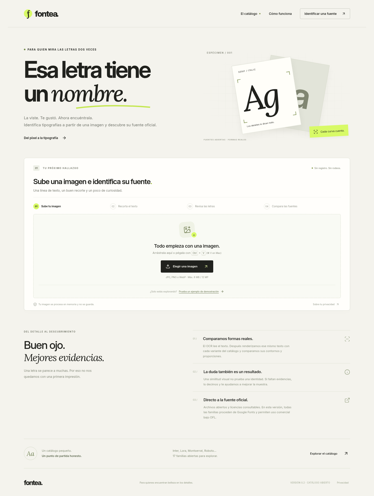

# Fontea

Versión 0.2: [mejoras medidas de OCR y catálogo](docs/MEJORAS-0.2.md). Se conserva íntegro el commit original `21f1e73`.

Aplicación web en español para buscar la tipografía de una imagen y consultar su origen y licencia. **Primera versión funcional sobre un catálogo limitado: 17 familias abiertas y 66 variantes. No confirma una identidad exacta ni cubre fuentes comerciales.**

Carga o pegado de imagen → recorte → OCR local editable → comparación de contornos con fuentes reales → candidatos y alternativas separados → ficha oficial, licencia y descarga autorizada. No usa resultados simulados, claves externas, cuentas ni servicios de pago. El ejemplo opcional está marcado como demostración y pasa por el mismo motor.



## Ejecutar

Requisitos: Node.js >=22.9 (recomendado 24 LTS), Python 3.12, Tesseract 5 y Linux. En Ubuntu instala `python3-venv` y `tesseract-ocr`; los datos oficiales de inglés y español ya se incluyen en el proyecto.

```bash
npm ci
python3 -m venv .venv
. .venv/bin/activate
pip install -r requirements.txt
cp .env.example .env
python scripts/doctor.py
npm run dev
```

Abre la dirección que imprime Vite (normalmente http://localhost:5173). Ejecuta Node con el entorno virtual activo o configura `PYTHON_BIN=/ruta/absoluta/.venv/bin/python3` en `.env`. Node carga `.env`; nunca lo subas a GitHub. No necesitas claves.

Producción local:

```bash
npm run build
npm start
```

Abre http://127.0.0.1:3001. El mismo servidor sirve React, API, fuentes y licencias. Una vez compilado puede ejecutarse con dependencias de producción (`npm prune --omit=dev`); para recompilar o probar vuelve a instalar las dependencias de desarrollo. `HOST=127.0.0.1` es el valor predeterminado; para desarrollo remoto usa el reenvío de puertos de tu entorno. No se ha publicado una URL alojada.

## Qué funciona y qué no

- PNG, JPG y WebP; 8 MB, 12 megapíxeles y 6000 píxeles por lado. Selección, arrastre y pegado; recorte con ratón, táctil o teclado.
- OCR Tesseract local con modelos oficiales `spa+eng` (español primero); transcripción revisable. Puedes elegir inglés primero y pulsar **Volver a leer** sobre el mismo recorte. Es imprescindible comprobar el texto.
- Comparación real de pesos 400/700, recta/cursiva cuando existe, con variantes de espaciado y tamaño óptico. Previews generados desde el archivo tipográfico comparado y superposición de contornos.
- Candidatos del catálogo, alternativas similares y estado sin identificación. Distancias de similitud sin porcentajes de confianza. **Ningún resultado se etiqueta como exacto.**
- Descargas de archivos originales bajo SIL OFL 1.1, licencias por familia y diecisiete fichas oficiales comprobadas. Los archivos variables pueden contener más pesos que el comparado.
- Procesamiento en memoria, sin historial ni imágenes temporales; límite de concurrencia, tamaño, resolución, peticiones y tiempo. No se registran cuerpos, texto ni imágenes.

El catálogo contiene **Inter, Roboto, Open Sans, Montserrat, Lato, Poppins, Lora, Playfair Display, Source Serif 4, Roboto Mono, Oswald, Nunito Sans, Raleway, DM Sans, Bitter, Fira Sans y Libre Franklin**. Oswald solo tiene las dos variantes rectas. Archivos y licencias fijados a una revisión del repositorio oficial Google Fonts; consulta [`catalog/manifest.json`](catalog/manifest.json).

La muestra debe ser una sola línea de texto latino, 3–80 caracteres, horizontal y con fondo uniforme. No se corrige perspectiva ni se identifican de forma fiable logos alterados, efectos, fuentes mezcladas o fuentes fuera del catálogo. Pocas letras o baja resolución pueden dejar solo alternativas. Un clon externo puede ser indistinguible: una distancia baja no prueba identidad. Detalles en [el informe del motor](docs/ENGINE.md).

Prueba las [cinco imágenes de demostración](public/ejemplos/README.md), con origen conocido y casos de tildes, nuevas familias, inglés y una fuente fuera del catálogo. Son entradas reales del motor, no resultados simulados.

## Verificación y entrega

```bash
npm run build
npm test
python scripts/doctor.py
```

Pruebas de API: OCR/comparación reales, correspondencia de bytes y licencias, formatos inválidos, límites de tamaño/dimensiones, muestras insuficientes, concurrencia y recuperación tras timeout. La comparación pareada antes/después está en [MEJORAS-0.2.md](docs/MEJORAS-0.2.md); el informe histórico de la versión inicial permanece en [TESTING.md](docs/TESTING.md). Ninguno equivale a una precisión general.

Capturas: [ordenador](docs/desktop.png), [móvil](docs/mobile.png), [recorte](docs/crop-desktop.png), [resultados en ordenador](docs/results-desktop.png) y [resultados en móvil](docs/results-mobile.png). Se generaron con Chromium; no se han probado dispositivos físicos.

Para reproducir el navegador y los experimentos (con el servidor arrancado):

```bash
pip install -r requirements-dev.txt
# Los scripts usan /usr/bin/chromium; instala Chromium si no está disponible.
python scripts/ui_smoke.py http://127.0.0.1:3001
python benchmarks/revision.py --generate --run
```

Las imágenes sintéticas se generan en `tests/artifacts`, que no se versiona. Las transcripciones, fuentes esperadas, distancias y resultados por muestra sí se incluyen en `docs/*-results.csv`. Los scripts de descarga solo sirven para restaurar las fuentes/modelos fijados: no se ejecutan al arrancar ni al analizar.

## Despliegue y ampliaciones

[Guía de Ubuntu + Nginx + systemd](docs/UBUNTU.md). Está preparada; no se ha accedido a ningún VPS ni se han aplicado esos comandos en un servidor tuyo.

Fuentes comerciales, búsqueda en catálogos mayores, corrección geométrica y APIs externas quedan pendientes. Antes de añadir un proveedor hay que verificar acceso, términos, enlaces y licencias, y conocer su tarifa. No se ha contratado ningún servicio; el flujo actual funciona sin claves. El alojamiento posterior tendrá el coste de la infraestructura que elijas. [Arquitectura y contrato de ampliación](docs/ENGINE.md).

## Fuentes y licencias de terceros

Las fuentes permanecen sin modificar, con licencias y avisos originales en `catalog/licenses`. Permiten uso personal y comercial bajo OFL; conserva sus condiciones si redistribuyes. Los datos OCR de Tesseract conservan su licencia Apache 2.0 en `engine/tessdata/LICENSE`, procedencia y hashes. Las bibliotecas se declaran en `package-lock.json` y `requirements.txt`.

## Rama y respaldos

La rama de trabajo sigue siendo `codex/fontea-v1` y conserva el commit original `21f1e73`. Los cambios de la versión 0.2 se añaden encima; no se rehace el proyecto. ZIP y bundle se generan desde el commit final, con respaldos separados de la versión inicial. El resultado del envío a GitHub se indica en la entrega de la sesión; la conexión requiere permisos de escritura sobre el repositorio. No se ha desplegado ni publicado en un VPS.
